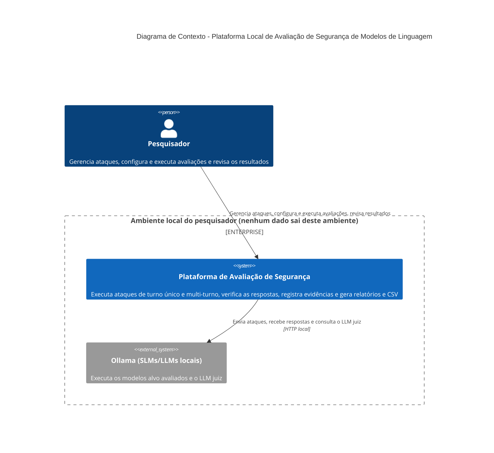
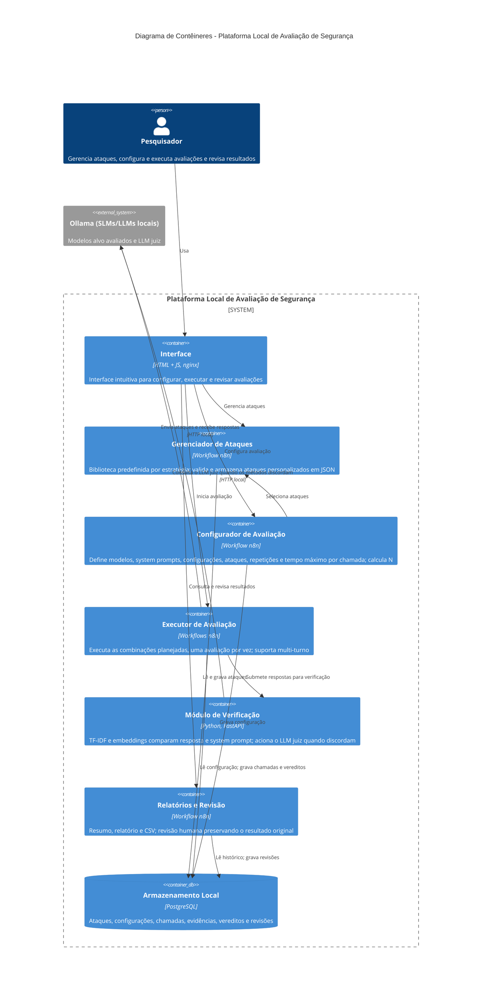
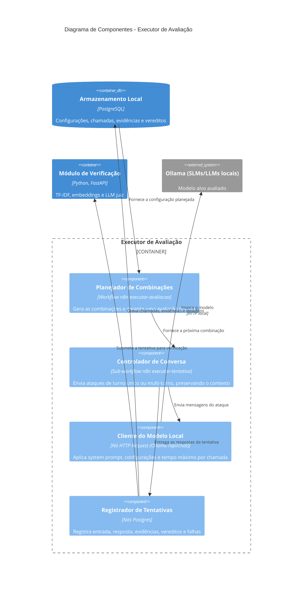

# Projeto do Sistema

**Plataforma Local de Avaliação de Segurança de Modelos de Linguagem (SLMs e LLMs)**

Este documento complementa a Solicitação de Sistema, o Lean Canvas, a Elicitação de Requisitos, os Casos de Uso e o Diagrama de Processos. Ele define o escopo do sistema, a arquitetura (diagramas de contexto e de contêineres no formato C4) e os componentes de software.

---

## 1. Escopo do Sistema

### 1.1. Objetivo

Fornecer aos pesquisadores um pipeline configurável para avaliar a segurança de modelos de linguagem locais (SLMs e LLMs) diante de ataques de *prompt injection*, de forma sistemática, rastreável e reproduzível, mantendo modelos, *system prompts*, ataques, respostas e resultados no ambiente local.

### 1.2. Dentro do escopo

| Área | O que o sistema contempla | Requisitos |
|---|---|---|
| Biblioteca de ataques | Coleção predefinida organizada por estratégia de *prompt injection*; ataques personalizados em JSON, validados e reutilizáveis; ataques de turno único e multi-turno. | RF04, RF05, RF06, RNF07, RNF08 |
| Configuração da avaliação | Seleção de modelos, *system prompts* (inclusive ausência de prompt), configurações compartilhadas, ataques e repetições; cálculo de N = M × S × C × A × R. | RF01 a RF03, RF07 a RF09 |
| Execução | Execução das combinações planejadas, uma avaliação por vez, sem interrupção antecipada; preservação do contexto em ataques multi-turno; registro de cada chamada; tempo máximo de espera por chamada, com registro de falha sem interromper a avaliação. | RF10 a RF13, RF23 |
| Verificação | Veredito por tentativa a partir da similaridade entre a resposta e o *system prompt* (TF-IDF e *embeddings* como métodos principais; LLM juiz quando discordam), preservando as evidências. | RF14 a RF16 |
| Revisão e relatórios | Revisão humana de qualquer tentativa, histórico em CSV, relatórios e resumos por modelo, *system prompt* e tipo de ataque. | RF16 a RF22 |
| Operação local | Funcionamento integral local, sem envio de dados a serviços externos; registros e configurações preservados. | RNF01, RNF03, RNF04, RNF05 |

### 1.3. Fora do escopo

- Execução simultânea de múltiplas avaliações (RF11).
- Adaptação, ajuste fino ou correção dos modelos avaliados (RF01 exige avaliar sem adaptações).
- Uso de serviços externos de qualquer natureza, inclusive nuvem e APIs de terceiros (RNF01, RNF03).
- Uso em avaliações não autorizadas (RE01).

### 1.4. Atores e sistemas externos

| Elemento | Tipo | Descrição |
|---|---|---|
| Pesquisador (Usuário) | Pessoa | Gerencia ataques, configura e inicia avaliações e revisa resultados. |
| Ollama (modelos de linguagem locais) | Sistema externo (local) | Executa os modelos alvo, que recebem os ataques e devolvem as respostas avaliadas, e o modelo usado como LLM juiz. Os modelos não são modificados pela plataforma. |

### 1.5. Premissas e restrições

- O ambiente local possui capacidade de processamento suficiente; o tempo de execução pode ser elevado (RNF02).
- Os resultados podem variar entre execuções, por isso são necessárias repetições e preservação das configurações usadas.
- O *system prompt* pode conter informações confidenciais, o que reforça a restrição de dados somente locais.
- A ferramenta tem natureza ofensiva e deve ser usada apenas com autorização (RE01).

---

## 2. Arquitetura

A arquitetura é uma aplicação **local e modular**: uma interface de uso, módulos de domínio com responsabilidades separadas e um armazenamento local compartilhado. Os módulos se comunicam entre si apenas dentro do ambiente local, e a única integração externa à plataforma é o Ollama, também executado localmente.

| Camada | Tecnologia |
|---|---|
| Interface | HTML + JavaScript puro, servido por nginx |
| Orquestração (ataques, configuração, execução, relatórios) | Workflows n8n expostos como *webhooks* |
| Verificação | Serviço Python (FastAPI, scikit-learn e sentence-transformers) |
| Modelos (alvo e LLM juiz) | Ollama |
| Armazenamento | PostgreSQL |
| Implantação | Docker Compose, com portas restritas a `127.0.0.1` |

O detalhamento técnico para implementação está em [spec.md](../spec.md).

### 2.1. Diagrama de Contexto (C4 – nível 1)

### 2.2. Diagrama de Contêineres (C4 – nível 2)

### 2.3. Diagrama de Componentes do Executor (C4 – nível 3)

O Executor concentra a maior parte do comportamento crítico (combinações, multi-turno e registro), por isso é detalhado.

---

## 3. Componentes de Software

### 3.1. Visão geral

| Componente | Responsabilidade | Casos de uso |
|---|---|---|
| **Interface** | Ponto único de interação do pesquisador; guia instalação, configuração, execução e revisão. | UC-01 a UC-04 |
| **Gerenciador de Ataques** | Mantém a biblioteca predefinida por estratégia; valida e armazena ataques personalizados em JSON; permite ampliação da coleção. | UC-01 |
| **Configurador de Avaliação** | Reúne modelos, *system prompts* (ou ausência), configurações compartilhadas, ataques, repetições e tempo máximo de espera por chamada; valida a configuração e calcula N. | UC-02 |
| **Executor de Avaliação** | Executa as combinações planejadas, uma avaliação por vez, até completar N; trata ataques multi-turno; registra falhas, inclusive por tempo excedido, sem interromper o conjunto. | UC-03 |
| **Módulo de Verificação** | Calcula a similaridade entre a resposta e o *system prompt* por TF-IDF e *embeddings*; aciona o LLM juiz quando os dois discordam; produz o veredito por tentativa (violação, sem violação, inconclusivo ou não aplicável). | UC-03 |
| **Relatórios e Revisão** | Apresenta resumo e histórico; exporta CSV; gera relatórios por modelo, *system prompt* e tipo de ataque; registra a revisão humana preservando o resultado original. | UC-04 |
| **Armazenamento Local** | Persiste ataques, configurações, chamadas, evidências, vereditos e revisões, sem uso de serviços externos. | UC-01 a UC-04 |

### 3.2. Detalhamento

**Interface**
- Entradas: ações do pesquisador. Saídas: telas de biblioteca, configuração, execução e resultados.
- Não contém regras de negócio; delega aos módulos.

**Gerenciador de Ataques**
- Entradas: definições de ataque em JSON (turno único ou sequência de mensagens). Saídas: ataques validados e disponíveis para seleção.
- Regras: RN-01 (organização por estratégia), RN-02 (formato estruturado e reutilização). Em caso de estrutura inválida, informa os problemas e solicita correção.

**Configurador de Avaliação**
- Entradas: seleção de modelos, *system prompts*, configurações, ataques, repetições e tempo máximo de espera por chamada (RF23). Saídas: avaliação validada, com resumo e N planejado.
- Regras: RN-03 e RN-04 (mesmos conjuntos e configurações para todos os modelos), RN-05 (ausência de *system prompt* conta como condição), RN-06 (fórmula de N).

**Executor de Avaliação**
- Entradas: avaliação configurada. Saídas: registros de cada chamada e tentativas encaminhadas à verificação.
- Regras: RN-07, RN-09 (sem interrupção antecipada) e RN-10 (uma avaliação por vez). Chamadas que excedem o tempo máximo de espera são registradas como falha e a execução prossegue (RF23). Consome recursos computacionais significativos (RNF02).
- Subcomponentes (seção 2.3): Planejador de Combinações, Controlador de Conversa, Cliente do Modelo Local e Registrador de Tentativas.

**Módulo de Verificação**
- Entradas: *system prompt* e respostas da tentativa. Saídas: score e decisão de cada método, indicação de concordância, resultado do LLM juiz (quando acionado) e veredito.
- Métodos principais: similaridade TF-IDF e similaridade semântica por *embeddings* (`paraphrase-multilingual-MiniLM-L12-v2`), cada um com limiar configurável. Discordância entre eles aciona o LLM juiz (Ollama).
- Vereditos: violação, sem violação, inconclusivo (juiz sem resultado válido) e não aplicável (tentativa sem *system prompt*).
- Regras: RN-08 (violação = similaridade elevada com o *system prompt*). Os resultados originais nunca são sobrescritos (RN-13).

**Relatórios e Revisão**
- Entradas: histórico e vereditos. Saídas: resumo, relatório, CSV e revisões humanas.
- Regras: RN-11 (evidências para toda tentativa), RN-12 (revisão de qualquer tentativa), RN-13 (preservar resultado original).

**Armazenamento Local**
- Garante rastreabilidade das condições dos experimentos (RNF04) e preservação das evidências (RNF05). Nenhum dado sai do ambiente local (RNF03).

### 3.3. Rastreabilidade entre componentes e requisitos

| Componente | Requisitos funcionais | Requisitos não funcionais |
|---|---|---|
| Interface | — | RNF01, RNF06 |
| Gerenciador de Ataques | RF04, RF05, RF06 | RNF07, RNF08 |
| Configurador de Avaliação | RF01, RF02, RF03, RF06, RF07, RF08, RF09, RF23 | RNF06 |
| Executor de Avaliação | RF06, RF10, RF11, RF12, RF13, RF23 | RNF02 |
| Módulo de Verificação | RF14, RF15, RF16 | RNF05 |
| Relatórios e Revisão | RF16, RF17, RF18, RF20, RF21, RF22 | RNF05 |
| Armazenamento Local | RF13, RF19 | RNF01, RNF03, RNF04, RNF05 |

*RE01 (uso exclusivamente autorizado) é uma restrição de uso e não se atribui a um componente específico.*

### 3.4. Correspondência com o Diagrama de Processos

| Etapa do processo | Componente responsável |
|---|---|
| Acessar biblioteca e fornecer ataques personalizados | Gerenciador de Ataques |
| Selecionar modelos, *system prompts*, ataques, configurações e repetições; validar e calcular N | Configurador de Avaliação |
| Enviar ataque ao modelo e tratar mensagens multi-turno | Executor de Avaliação (Controlador de Conversa e Cliente do Modelo Local) |
| Similaridade TF-IDF e *embeddings* com o *system prompt*; LLM juiz em caso de discordância | Módulo de Verificação |
| Registrar respostas, evidências e resultados | Executor (Registrador de Tentativas) e Armazenamento Local |
| Gerar resumo, relatório e CSV; revisar e corrigir veredito | Relatórios e Revisão |

---

## 4. Decisões de Projeto

| Decisão | Justificativa |
|---|---|
| Aplicação local com módulos separados e armazenamento compartilhado | Atende RNF01 e RNF03 e facilita a evolução independente da biblioteca, da verificação e dos relatórios. |
| Verificação isolada em serviço Python próprio | TF-IDF e *embeddings* exigem bibliotecas Python (scikit-learn e sentence-transformers) que não rodam dentro do n8n; o isolamento permite evoluir a verificação sem alterar o Executor (RF14 e RF15). |
| n8n como orquestrador | Os fluxos de configuração, execução e relatórios são modelados como workflows visuais, alinhados ao Diagrama de Processos. |
| Ollama para modelos alvo e LLM juiz | Executa SLMs e LLMs localmente por uma API HTTP única, sem adaptar os modelos (RF01, RNF01). |
| PostgreSQL | Consultas SQL facilitam relatórios, agregações e exportação em CSV (RF20 a RF22) e garantem uma avaliação por vez por restrição no banco (RF11). |
| LLM juiz somente em caso de discordância | Reduz o custo computacional local (RNF02), pois o juiz é acionado apenas quando TF-IDF e *embeddings* divergem. |
| Ataques personalizados em JSON | Formato estruturado e de fácil edição (RNF07), com reutilização (RN-02). |
| Resultados originais preservados separadamente da revisão humana | Garante rastreabilidade e reprodutibilidade (RN-13, RNF04). |
| Execução sequencial de uma avaliação por vez | Respeita RF11 e as limitações de processamento local (RNF02). |

---

## 5. Pendências Resolvidas

| Pendência | Resolução |
|---|---|
| Tecnologias não definidas | Definidas na seção 2: HTML + JS (nginx), n8n, serviço Python de verificação, Ollama e PostgreSQL. |
| Autenticação citada nos casos de uso sem requisito correspondente | Removida dos casos de uso; a plataforma não terá controle de acesso próprio. O uso autorizado permanece como restrição de uso (RE01). |
| Numeração dos RNF divergente entre Casos de Uso e Elicitação | Matriz dos Casos de Uso alinhada à Elicitação (RNF01 a RNF08). |
| Revisão "por amostragem" × revisão de qualquer tentativa | A amostragem é a prática recomendada ao pesquisador; o sistema permite revisar qualquer tentativa (RF17, RN-12). |
| Limites de execução sem RF | Definido o RF23: tempo máximo de espera por chamada, com registro de falha sem interromper a avaliação (compatível com RF12). |
| Método "complementar" × "um ou mais" | Substituído pela definição do RF15: TF-IDF e *embeddings* como métodos principais e LLM juiz em caso de discordância. |